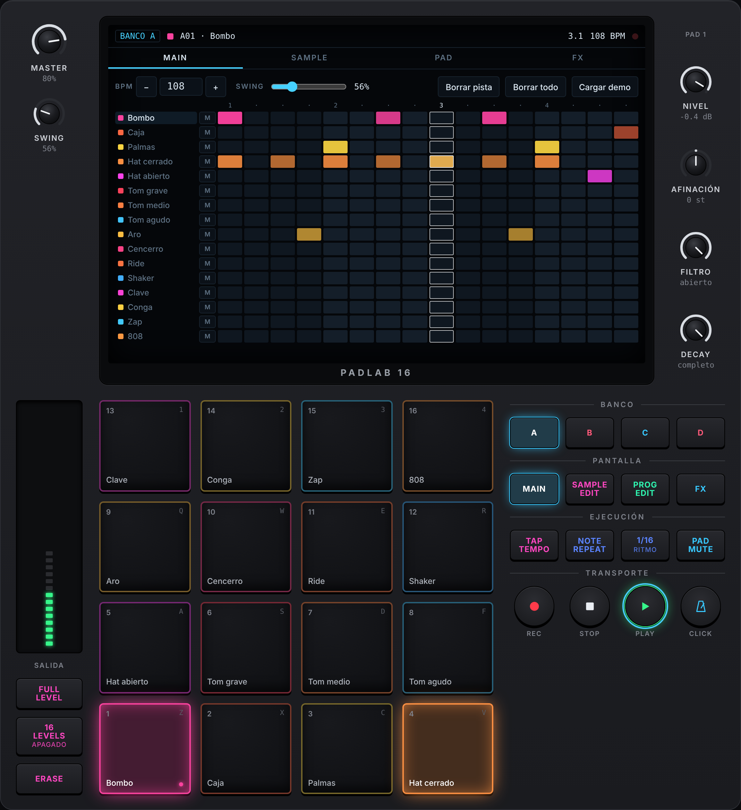

# PadLab 16

Sampler de pads para el navegador, simplificado y en un solo archivo HTML. Está inspirado en el código abierto del **Behringer KICK** ([MusicTribeOpenSource/0700-AAM](https://github.com/MusicTribeOpenSource/0700-AAM)).



> Proyecto independiente con fines educativos. No está afiliado ni respaldado por Music Tribe ni Behringer. «Behringer» y «KICK» son marcas de sus respectivos dueños.

## Cómo usarlo

**Opción 1: abrir el archivo.** Descarga `index.html` y ábrelo con doble clic. No necesita instalación, servidor ni conexión a internet. Solo la tipografía viene de Google Fonts; sin conexión se usa la del sistema.

**Opción 2**: GitHub Pages en:

[PadLab](https://tomascenfo.github.io/padlab/)


Navegadores probados: Chrome y Edge. También debería funcionar en Firefox y Safari en sus versiones recientes. El audio arranca con el primer toque o clic, porque así lo exigen los navegadores.

## Funciones

### Pads y bancos
- 16 pads sensibles a la velocidad: tocar más arriba en el pad suena más fuerte.
- 4 bancos (A–D), o sea 64 sonidos:
  - **A**: batería (bombo, caja, palmas, hats, toms, aro, cencerro, ride, shaker, clave, conga, zap, 808).
  - **B**: bajo sintetizado en escala pentatónica menor (C2–C5).
  - **C**: acordes m7 y campanas FM.
  - **D**: efectos (subida, caída, láser, vinilo, drone, blip, glitch, impacto) y 8 pads vacíos para tus samples.
- Todos los sonidos de fábrica se sintetizan en el navegador con `OfflineAudioContext`, así que no hay archivos de audio externos.
- **Full Level**: todos los golpes a velocidad 127.
- **16 Levels**: reparte el pad seleccionado en los 16 pads, por velocidad o por semitonos.
- **Pad Mute** y **Erase**: silencian o borran la pista de un pad al tocarlo.

### Edición de sample (Sample Edit)
- Carga de audio por botón o arrastrando un archivo sobre un pad o sobre la onda. Acepta WAV, MP3, OGG, FLAC y M4A, según el navegador.
- Grabación con el **micrófono** y **remuestreo** de la salida maestra hacia el pad seleccionado.
- Marcadores de inicio y fin sobre la forma de onda.
- Botones para recortar el silencio, normalizar y volver a la región completa.

### Parámetros por pad (Prog Edit)
- Nivel, paneo, afinación (±36 semitonos), filtro pasa-bajos, resonancia, ataque y decay.
- Modos **One-shot**, **Gate** y **Loop**, y dirección normal o en **reversa**.
- **Grupos de corte** (choke): por ejemplo, el hat cerrado corta al abierto.

### Secuenciador (Main)
- Patrón de 16 pasos para las 64 pistas a la vez.
- BPM de 40 a 240, **swing** de 50 % a 75 %, **Tap Tempo** y metrónomo.
- Grabación en vivo (**REC**) cuantizada a 1/16.
- **Note Repeat** a 1/8, 1/16, 1/16T y 1/32, sincronizado al tempo.

### FX maestro
- Pad **XY**: el eje X va de pasa-bajos a pasa-altos y el eje Y controla la resonancia.
- **Delay** sincronizado (1/8, 3/16, 1/4) con feedback, **reverb** por convolución y **drive** (saturación).
- Las perillas físicas **P1–P4** cambian según la pantalla:
  - En las vistas Main, Sample y Pad: Nivel, Afinación, Filtro y Decay del pad seleccionado.
  - En la vista FX: los efectos maestros.

## Teclado

| Teclas | Pads |
|---|---|
| `Z` `X` `C` `V` | 1–4 |
| `A` `S` `D` `F` | 5–8 |
| `Q` `W` `E` `R` | 9–12 |
| `1` `2` `3` `4` | 13–16 |
| `Espacio` | Play / Stop |

Las perillas responden al arrastre vertical, a la rueda del mouse y a las flechas del teclado. Mantén `Shift` para un ajuste fino y haz doble clic para volver al valor por defecto.

## Dónde se guardan los datos

Todo queda en el navegador de quien lo usa; nada se envía a ningún servidor.
- El patrón y los ajustes van en `localStorage`.
- Los samples propios van en `IndexedDB`.
- El botón **Cargar demo** restaura el patrón y los sonidos de fábrica. Borra los samples propios.

## Arquitectura

Todo el proyecto es un único `index.html` con HTML, CSS y JavaScript sin dependencias. Usa la Web Audio API.

```
Pads / secuenciador
   └─ voz por golpe: AudioBufferSource → Biquad LP → Gain (envolvente) → StereoPanner
        └─ bus de pads → Drive (WaveShaper) → Filtro LP/HP maestro ─┬─→ Master → Analyser → salida
                                                                    ├─→ Delay (feedback + LP) ─→ Master
                                                                    └─→ Reverb (Convolver) ────→ Master
```

- **Reloj**: un programador con *lookahead* (un `setInterval` cada 25 ms que agenda 120 ms por delante en el reloj de audio). Mantiene el tiempo estable aunque la interfaz esté ocupada.
- **Grabación en vivo**: cuantiza al paso de 1/16 más cercano y evita que la nota suene doble cuando cae en el paso siguiente.
- **Captura** (micrófono o remuestreo): un `ScriptProcessorNode` acumula las muestras en un `AudioBuffer` estéreo de hasta 30 s.

### Relación con el código del KICK

PadLab 16 es una reinterpretación simplificada; no compila ni reutiliza el código C++/JUCE original. Del repositorio 0700-AAM se tomaron como referencia:

| KICK (0700-AAM) | PadLab 16 |
|---|---|
| 16 pads RGB, 8 bancos (`kick_padButtonGroup`) | 16 pads, 4 bancos |
| `DrumVoice`: envolventes de amplitud, filtro y tono, LFO, paneo | Envolvente de amplitud (ataque/decay), filtro LP, paneo, afinación |
| `MTSamplePlayMode` (forward, loop, bidireccional, cue…) | One-shot, Gate, Loop, Reversa |
| Editor de sample con región inicio/fin | Marcadores I/F sobre la onda |
| Step sequencer, Note Repeat, Full Level, 16 Levels, Tap Tempo | Equivalentes simplificados |
| Más de 300 efectos y pantalla XY FX | 4 efectos maestros con pad XY |
| Cámara con IA, looper, MIDI, CV/Gate | No incluidos |

## Licencia

Elige la licencia que prefieras y agrégala como `LICENSE`. Este proyecto no copia código del repositorio 0700-AAM, que se distribuye bajo AGPL-3.0. Si quieres mantener la misma licencia que el original, usa AGPL-3.0.

## Créditos

Desarrollado en la Universidad CENFOTEC (Costa Rica) como recurso de enseñanza sobre audio digital y Web Audio.
